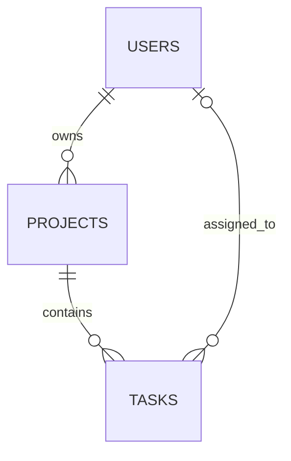

# Architecture

Status: T00 baseline only. Design below is the approved plan (D01), not implemented code.

- **Modular monolith.** Kotlin Spring Boot 3.5 backend, feature packages `com.taskflow.{auth,user,project,task,security,common}`, each with controller / service / repository layers and DTOs. React + Vite frontend talks to it over `/api`. PostgreSQL 17 with Flyway migrations (`backend/src/main/resources/db/migration`).
- **Security.** Stateless Spring Security resource server, HS256 JWT with a secret loaded only from the environment (`JWT_SECRET`, no default), BCrypt passwords. Ownership is always derived from the JWT subject.
- **Frontend state.** React Router, AuthContext for the session, TanStack Query for server state, local state for filters and modals. No Redux.
- **Current state (T01).** Persistence layer only: Flyway `V1__init_schema.sql` (users, projects, tasks with constraints and indexes), JPA entities `User`, `Project`, `Task` with enums `TaskStatus`/`TaskPriority`, Spring Data repositories with owner-scoped lookups, and an optional `demo` profile seeder. No controllers, services or security yet (T02/T03). Frontend is still the placeholder page.

HLD/UML and the persistence model live in the Notion plan (page 02) and are mirrored here when T01 starts. Diagrams go in `docs/diagrams/`.
