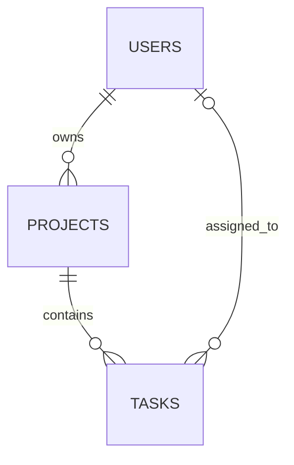

# Architecture

Status: T00 baseline only. Design below is the approved plan (D01), not implemented code.

- **Modular monolith.** Kotlin Spring Boot 3.5 backend, feature packages `com.taskflow.{auth,user,project,task,security,common}`, each with controller / service / repository layers and DTOs. React + Vite frontend talks to it over `/api`. PostgreSQL 17 with Flyway migrations (`backend/src/main/resources/db/migration`).
- **Security (T02, implemented).** Stateless Spring Security resource server; `JwtEncoder`/`JwtDecoder` are Nimbus beans (`security/JwtConfig`), HS256 key from `JWT_SECRET` (base64, 32+ bytes, startup fails without it), BCrypt passwords (72-byte bound). CSRF is disabled because no cookie authenticates requests; no CORS rules (same-origin or Vite proxy). Entry point and access-denied handler write the same `ApiError` JSON as the controller advice. Ownership is always derived from the JWT subject.
- **Project/task flow.** `ProjectController / TaskController → ProjectService / TaskService → ProjectRepository / TaskRepository`; `UserLookupController → UserLookupService → UserRepository`. Services return DTOs, mapped inside the transaction.
- **Patterns.** *Repository*: `ProjectRepository` and `TaskRepository` extend Spring's bare `Repository`, not `JpaRepository` and not `JpaSpecificationExecutor`, so `findById`, `findAll`, `deleteById`, `count`, `exists` and the specification-taking variants do not exist on them. `RepositoryGuardTest` pins the exact method list. *Specification*: the filtered task list is the repository fragment `TaskPageQuery.findPage(ownerId, projectId, query)`; its implementation builds `TaskSpecifications.scoped(projectId, ownerId)` plus the optional status/priority/assignee filters itself, so a caller cannot leave the scope out. *Strategy*: `TaskSortStrategy` with `DueDateSort` and `PrioritySort` (rank CASE expression, nulls last, id tie-break), chosen by `TaskSortField`.
- **Auth flow.** `AuthController → AuthService → UserRepository / PasswordEncoder / TokenService`; errors go through `GlobalExceptionHandler`.
- **Frontend state.** React Router, AuthContext for the session, TanStack Query for server state, local state for filters and modals. No Redux.
- **Current state (T03).** T01 persistence, T02 auth, plus the project and task API (backend only). Persistence layer: Flyway `V1__init_schema.sql` (users, projects, tasks with constraints and indexes), JPA entities `User`, `Project`, `Task` with enums `TaskStatus`/`TaskPriority`, Spring Data repositories with owner-scoped lookups, and an optional `demo` profile seeder. Frontend is still the placeholder page.

HLD/UML and the persistence model live in the Notion plan (page 02) and are mirrored here when T01 starts. Diagrams go in `docs/diagrams/`.
