# Architecture & UML

[README](../../README.md) | **Architecture & UML**

Mermaid source of truth for the as-built system, reviewed against the code on 25 Nov 2026 (after the page-offset fix). GitHub renders them. The original design sketches are in the Notion plan (page 02); where they differ, these win.

## 1. System (HLD)
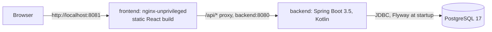
One origin for the browser, so no CORS rules. Details in [Deployment](#14-deployment).

## 2. Backend components
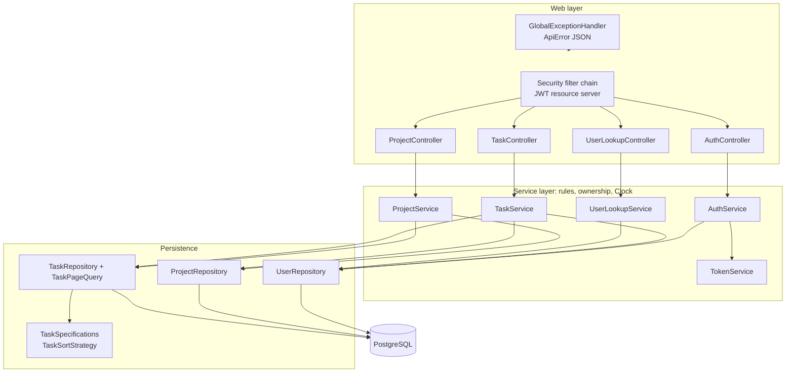
Controllers take the user id only from the JWT. Services return DTOs, mapped inside the transaction.

## 3. Use cases
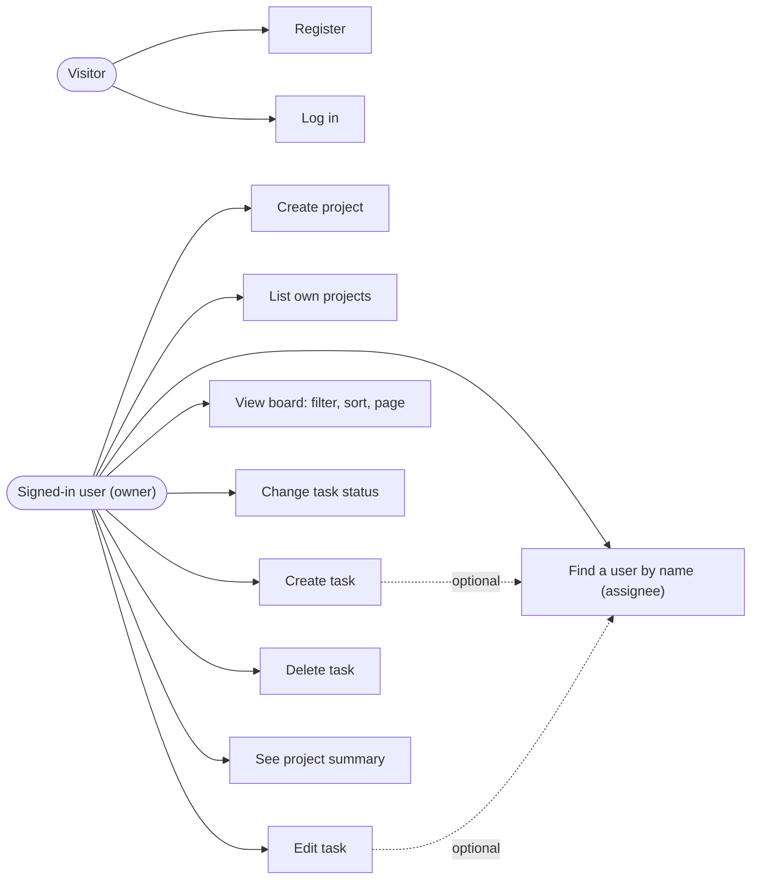
There is no separate owner role: the signed-in user may use only projects and tasks they own. An assignee gets no access (404 for everyone else, D06).

## 4. Data model (ERD)
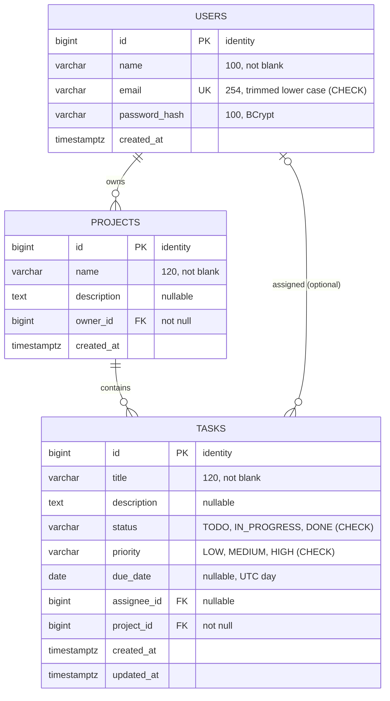
Indexes (V1 migration): `projects(owner_id, id)`; `tasks(project_id, status, id)`, `tasks(project_id, due_date, id)`, `tasks(project_id, assignee_id)`. Foreign keys have no cascade, and there is no delete for projects or users.

## 5. Classes: auth and security
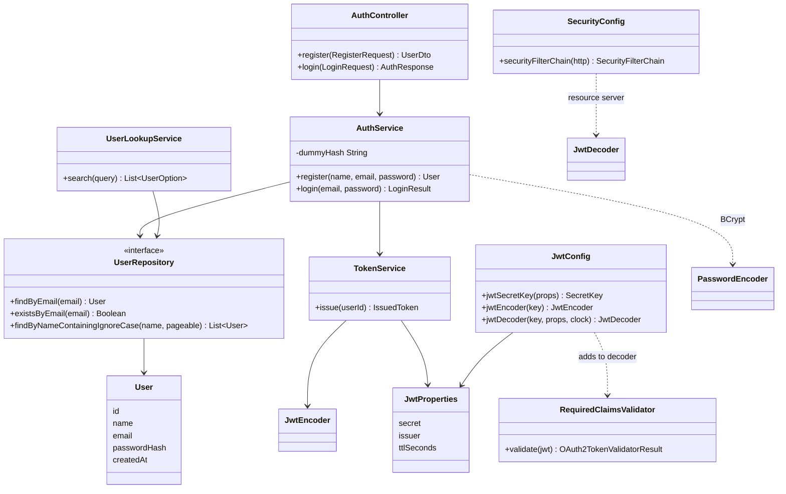

## 6. Classes: project, task and persistence
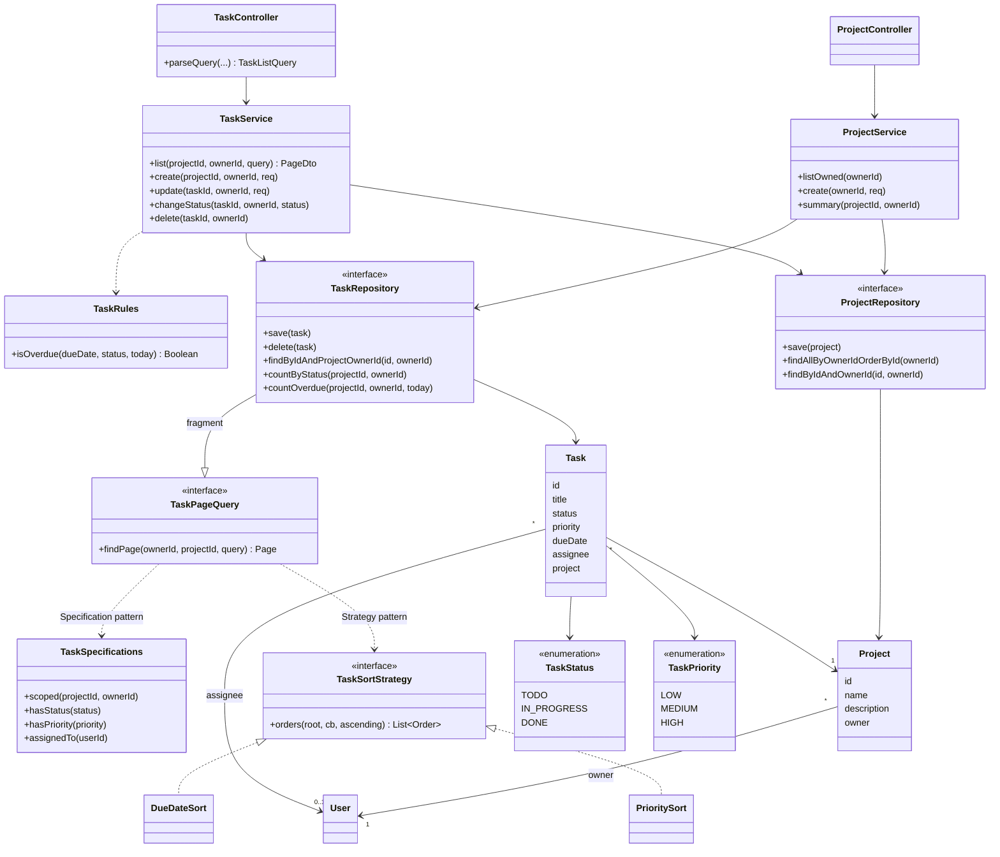
`ProjectRepository` and `TaskRepository` extend Spring Data's bare `Repository`: every lookup and query takes the owner id. Mutations act on entities loaded through scoped lookups or new entities attached to the authenticated owner or an owned project. `UserRepository` is a `JpaRepository` (not owner-scoped).

## 7. Sequence: register
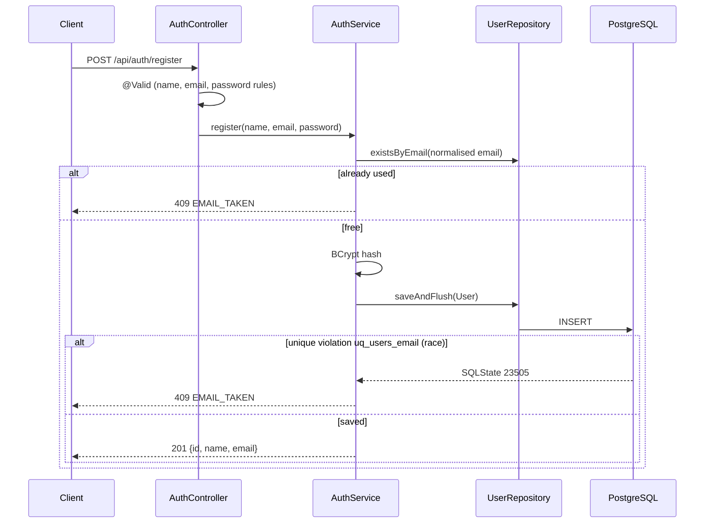

## 8. Sequence: login
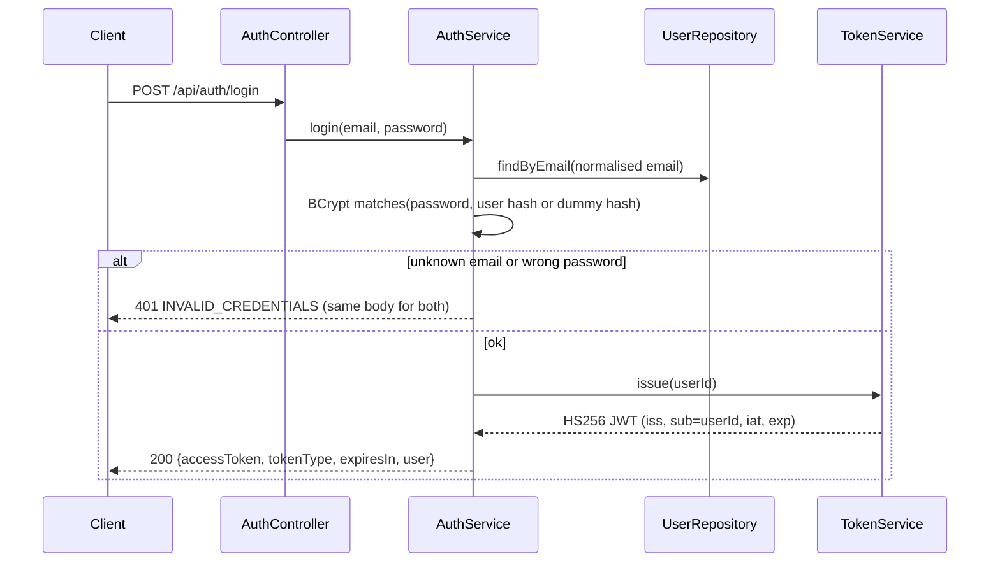

## 9. Sequence: JWT filter and authorization
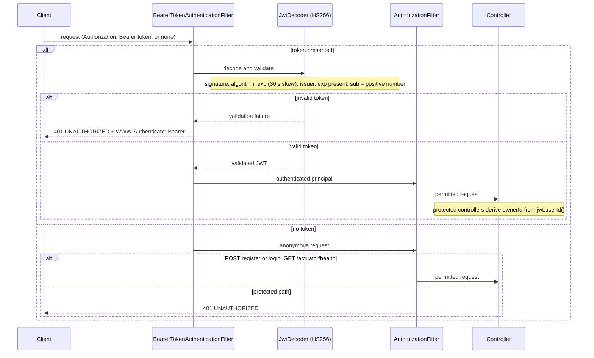
There is no per-request user lookup: a valid token is trusted until it expires. Ownership is enforced later, in the service (diagram 10).

## 10. Sequence: task create, update and status change (ownership)
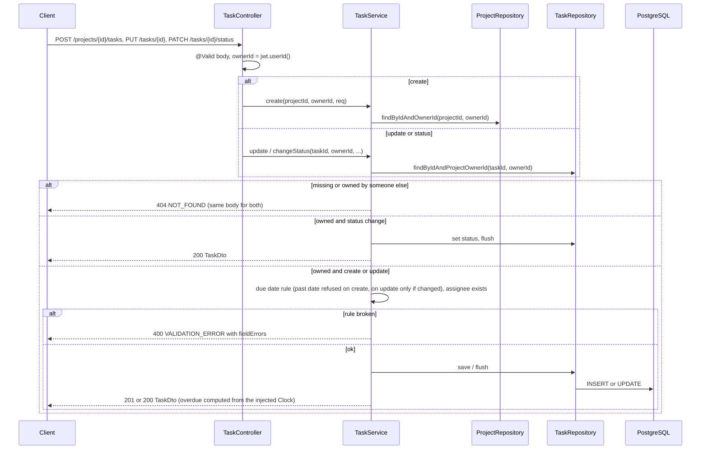

## 11. State machine: task status
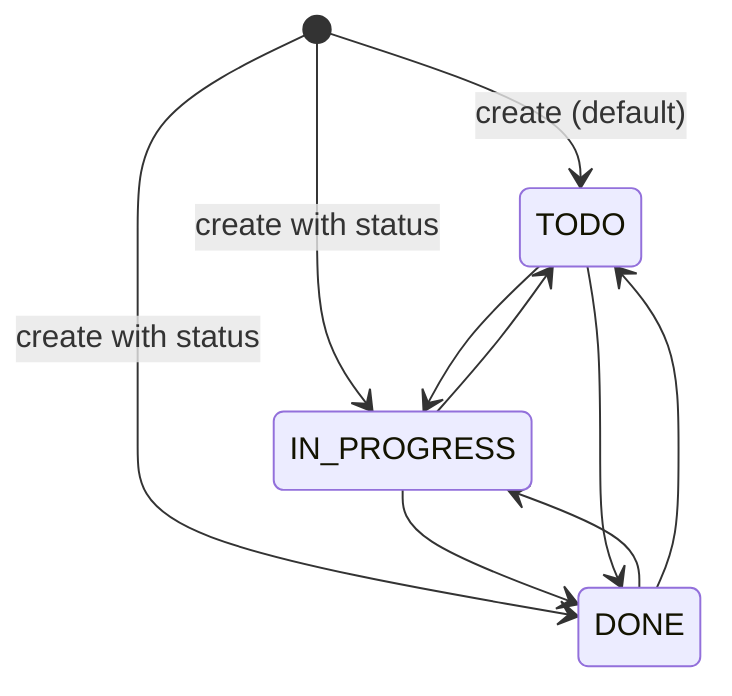
Every transition is allowed (D05); the same status is a no-op that still returns 200. "Overdue" is not a state: it is derived (due before today UTC and status not DONE).

## 12. Sequence: filter, sort and page
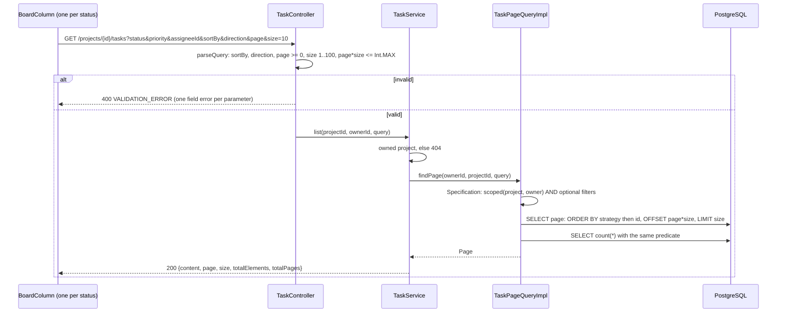
The two selects run in one read-only transaction, but under Read Committed each sees its own snapshot. Ordering is deterministic for a fixed result set; offset paging can repeat or skip a row if tasks change between page requests (see [backend audit](../backend-audit.md)).

## 13. Frontend data flow
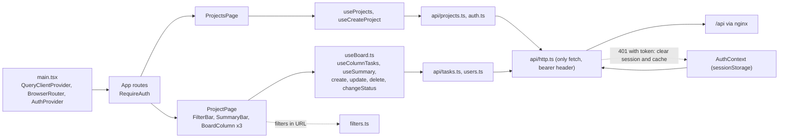
Query keys start with the user id (`['user', uid, 'project', pid, ...]`). Each mutation invalidates the whole project prefix, so all three columns and the summary refetch.

## 14. Deployment
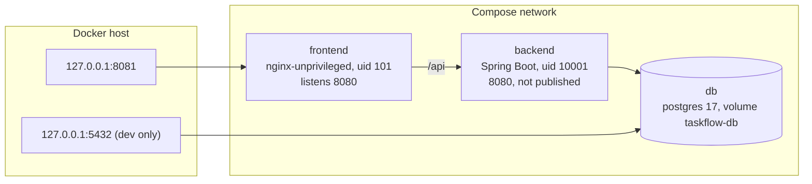
Start order: db healthy, then backend (`/actuator/health`), then frontend. `JWT_SECRET` and `POSTGRES_PASSWORD` come from `.env` and are required.
